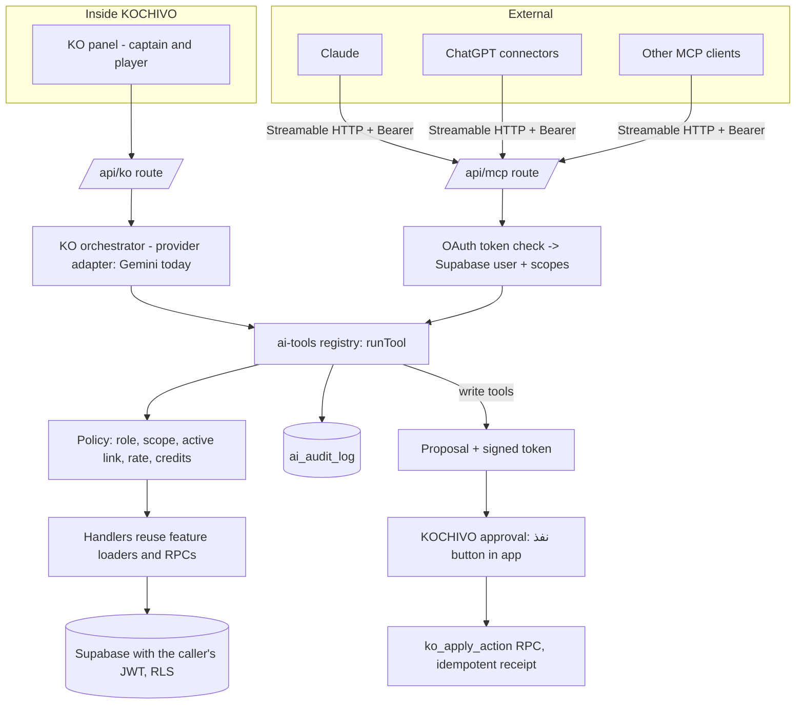

# 02: AI integration architecture

## 1. Shape



The two entry points differ only in who chooses the tool:
- In the **KO panel**, our model (Gemini) picks the tool.
- In an **MCP client**, the coach's own AI (Claude, ChatGPT) picks it.

After the tool is chosen, everything is the same code: `runTool(actor, name, args, { client })`.

## 2. The registry (`src/features/ai-tools`)

```ts
type AiTool<I, O> = {
  name: string; title: { ar: string; en: string }; description: string; // English for models
  input: z.ZodType<I>; output: z.ZodType<O>;
  roles: readonly ('captain' | 'player')[]; scope: 'kochivo.read' | 'kochivo.write';
  kind: 'read' | 'propose';            // no tool writes directly
  run(ctx: ToolContext, input: I): Promise<O>;
};
type ToolContext = { actor: { id; role; db /* user-scoped Supabase client */ }; client: 'ko' | `mcp:${string}`;
  correlationId: string; now: Date; timezone: string; signal: AbortSignal };
```

- `runTool` does these steps in order:
  1. Looks up the tool.
  2. Checks the role and the scope.
  3. Parses the input with Zod.
  4. Checks the rate limit and credits.
  5. Runs the handler with a timeout (8 s for reads).
  6. Parses the output with Zod.
  7. Writes the audit row.
  8. Returns `{ ok: true, data }` or `{ ok: false, error: { code, message } }`.
- Error codes: `unauthorized`, `forbidden`, `invalid_input`, `not_found`, `rate_limited`, `timeout`, `unavailable`.
- KO's current `intents.ts` tools move into this registry as thin adapters. Their behavior stays the same and is guarded by the existing KO tests plus the T-390 eval.

### Initial read tools (only ones the app supports)

| Tool | Role | Source |
|---|---|---|
| `get_coach_profile` | captain | profiles + plan summary (name, plan tier, used/limit, timezone). No email or phone. |
| `list_athletes` | captain | `captain_roster()`: id, display name, status, access_until, adherence. |
| `get_athlete_details` | captain | one roster player: program, nutrition plan, subscription end, last workout. |
| `get_athlete_progress` | captain, player (self) | read-progress logic: monthly done/planned, adherence, rank, points, last body scan date. |
| `list_workout_programs` / `get_workout_program` | captain | programs, days, exercises. |
| `list_exercises` | captain | catalog plus own exercises (name, muscle, tool). |
| `get_expiring_subscriptions` | captain | `access_until` within N days (1–30). |
| `get_coach_analytics` | captain | team leaderboard, active count, adherence this month vs last. |
| `get_dues` | captain | `captain_dues()` totals per player, read-only. |
| `get_pt_balances` | captain | `sessions_left` per player, replacing "bookings". |

**Not proposed:** `get_upcoming_bookings`, because there is no booking system (see 01 §3).

### Write tools: designed, inactive

`update_program_exercise` (exists as `update_exercise`), `create_workout_program` (draft, exists), `assign_workout_program`, `renew_subscription` (exists), `send_reminder` (exists), `draft_renewal_message`, `create_athlete_invitation`.

All of them are `kind: 'propose'`. The tool returns `{ proposalId, summary, diff, approveUrl }` and changes nothing. A change happens only through the approval step below.

## 3. Write lifecycle (reuses `ko_apply_action`)

1. The tool validates the request and loads current values.
2. It returns a proposal with the exact diff and a signed token. The token is single-use, expires in 10 minutes, and is bound to `captain_id`, `action_id` and a hash of the payload.
3. The diff is shown:
   - in the KO panel, as a card with a «نفذ» button;
   - for MCP, as a link to `kochivo.site/captain/ai/approve/<id>`, where the captain signs in and approves inside KOCHIVO.

   An external client's own tool-approval button never counts as approval.
4. `ko_apply_action` re-checks the role, the link and the current data. It writes the receipt (idempotent on retries), applies the change and returns the verified row.
5. The audit row records the status `applied`, `rejected` or `expired`.

## 4. MCP server

- **Transport:** Streamable HTTP, **stateless** (no session store). JSON-RPC methods `initialize`, `tools/list` and `tools/call`. One POST → one JSON response. SSE streaming is not needed for tools that finish in under 10 s.
- **Vercel fit:** a Node runtime route handler at `src/app/api/mcp/route.ts`, outside `[locale]`, excluded from the locale proxy. Stateless requests fit Vercel functions and Fluid compute. No Redis, no queue, no separate server.
- **Library:**
  - Option A: the official `@modelcontextprotocol/sdk`. This is a **new dependency** and needs owner approval.
  - Option B: about 150 lines of our own JSON-RPC for the three methods.

  Recommendation: **A**, because protocol versions change and the SDK tracks them. Option B is the fallback if the dependency is refused.
- **Auth:**
  1. First choice: **Supabase Auth OAuth 2.1 server** (authorization code with PKCE, dynamic client registration, discovery metadata). If it is available on our plan, MCP clients get Supabase-issued tokens and RLS still applies. This needs verifying in the dashboard. It is a beta feature, so treat it as a spike.
  2. Fallback: our own small authorization server. It stores `ai_clients`, `ai_grants` and hashed refresh tokens, and issues short-lived tokens that our route exchanges server-side. More work.

  In both cases the consent screen is a KOCHIVO page (the mockup shows it) with scopes `kochivo.read` and later `kochivo.write`.
- **Discovery:** `/.well-known/oauth-protected-resource` on our domain points to the authorization server metadata.

### Client compatibility matrix (to be verified by real tests, not assumed)

| Client | Remote MCP + OAuth | Status for us |
|---|---|---|
| Claude (claude.ai custom connectors, Claude Desktop, Claude Code) | Supported by the product | Test in M3 |
| ChatGPT (connectors / developer mode) | Supported on some plans | Test in M3, plan-dependent |
| Gemini (Gemini CLI) | Gemini CLI supports MCP; the Gemini web app is not confirmed | Test the CLI only |
| Cursor, VS Code, other MCP clients | Supported by the protocol | Test one |

## 5. Internal assistant (KO)

- KO stays the face (the helmet character, Egyptian voice).
- The orchestrator keeps a **provider adapter** (`ko-agent/providers/gemini.ts`) behind an interface `chooseTool(messages, tools) → call | text`, so a provider change does not touch the tools.
- **Two-step answer:**
  1. The model picks a tool.
  2. `runTool` returns verified data.
  3. A second short model call phrases the answer **only from that data**, with numbers copied, not generated.

  This is KO plan step 2, "natural replies".
- **Streaming:** optional. Show a tool status line («بشوف لاعيبتك…») first, then the reply.

## 6. Providers and cost

| Option | Notes |
|---|---|
| Gemini 3.5 Flash-Lite (current) | Cheapest. Function calling works. Good Egyptian Arabic. Cost is measured per message in T-390. |
| Claude Haiku-class / Sonnet-class | Better tool choice and Arabic, higher cost. Keep as an adapter option for the hard captain tasks (program drafting). |
| MCP path | **Costs us no model tokens.** The coach's own AI subscription pays for the model; we only serve tool calls. |

Usage limits: «رصيد KO» per captain per month, plus a per-player daily cap (owner decision 2026-11-16). Numbers wait for the T-390 cost measurement.
